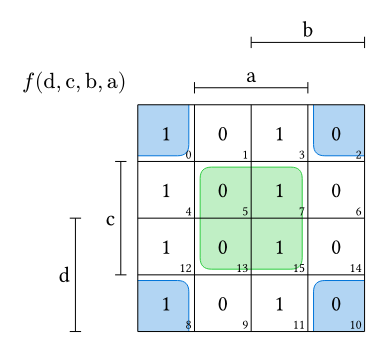
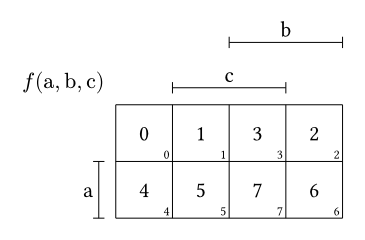
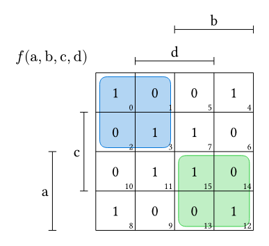
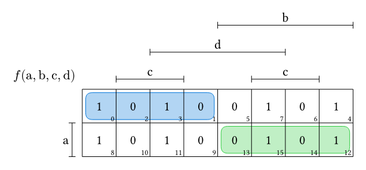
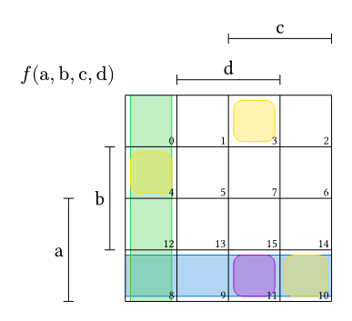
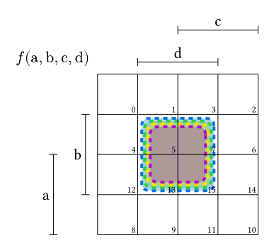
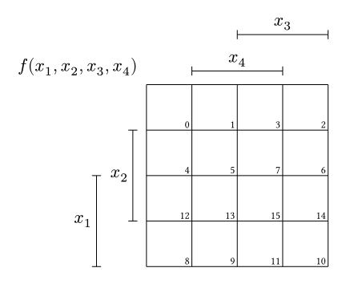
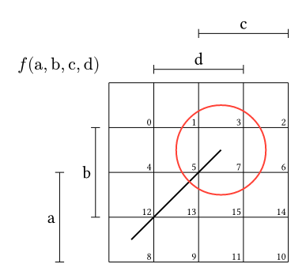

# Karnaugh

`karnaugh-express` is a [Typst](https://github.com/typst/typst) package for creating highly customizable Karnaugh maps.

## Overview

The `karnaugh` function takes two required arguments: `variables` and `values`. You can pass a `terms` argument to automatically draw minterms or maxterms.

```typ
#import "@preview/karnaugh-express:1.0.0": karnaugh

#karnaugh(
  ("d", "c", "b", "a"),
  (1, 0, 0, 1, 1, 0, 0, 1, 1, 0, 0, 1, 1, 0, 0, 1),
  terms: ("!b & !a", "a | b"),
)
```
  
    
## Placement of Values

Values are automatically placed so that you can read them directly from a truth table. Take the following table:

| a | b | c | position |
| - | - | - | -------- |
| 0 | 0 | 0 | 0        |
| 0 | 0 | 1 | 1        |
| 0 | 1 | 0 | 2        |
| 0 | 1 | 1 | 3        |
| 1 | 0 | 0 | 4        |
| 1 | 0 | 1 | 5        |
| 1 | 1 | 0 | 6        |
| 1 | 1 | 1 | 7        |

```typ
#import "@preview/karnaugh-express:0.1.1": karnaugh

#karnaugh(
  ("a", "b", "c"),
  (0, 1, 2, 3, 4, 5, 6, 7),
)
```


## Arranging Variables on the Axis

### 1. Standard Arrangement
There are different ways of arranging variables on a Karnaugh map. One is the standard layout shown in the previous images. `karnaugh-express` supports two standard layouts that can be selected with the `arrangement-standard` argument. 

`arrangement-standard: 0` is used in the first image. It is the most common way of arranging variables on K-maps and thus the standard setting of this package. `arrangement-standard: 1` is a different option that is often used and looks like this.

```typ
#import "@preview/karnaugh-express:0.1.1": karnaugh

#karnaugh(
  ("a", "b", "c", "d"),
  (1, 0, 0, 1, 1, 0, 0, 1, 1, 0, 0, 1, 1, 0, 0, 1),
  arrangement-standard: 1,
  terms: ("!b & !a", "a & b")
)
```

    
### 2. Custom Arrangement
You can also specify a completely custom arrangement. Just provide an `arrangement` parameter as an array of two arrays. The first array contains the row axis variables, and the second array contains the column axis variables:

```typ
#import "@preview/karnaugh-express:0.1.1": karnaugh

#karnaugh(
  ("a", "b", "c", "d"),
  (1, 0, 0, 1, 1, 0, 0, 1, 1, 0, 0, 1, 1, 0, 0, 1),
  arrangement: (("a",), ("b", "d", "c")),
  terms: ("!b & !a", "a & b")
)
```


## Terms 

To select cells in the K-map, you need to pass the `terms` parameter, which is an array of strings. Each element of the array represents a separate term. Both minterms and maxterms are supported. For minterms, a term would look like `"a & !b"` and for maxterms, it would look like `"a | !b"`.

In case you ever want to select cells that do not form a minterm or maxterm, you can pass the `custom-highlightings` argument. This is an array of arrays of numbers. The numbers represent the indices of the cells. For example `((1, 3, 7),)`.

All together, this could look something like this.

```typ
#karnaugh(
  ("a", "b", "c", "d"), (),
  terms: ("!b & a", "c | d"),
  custom-highlightings: ((3, 10, 4), (11)),
)
```


### Gaps
Use highlight-inset to control the gap between the grid and a highlight outline.

When multiple highlights overlap, readability can be improved by varying the inset for each term. The amount by which successive highlights are offset is determined by highlight-stroke. Use highlight-steps to specify how many different inset levels should be used before the pattern repeats.

```typ
#import "@preview/karnaugh-express:0.1.1": karnaugh

#karnaugh(
  ("a", "b", "c", "d"), (),
  terms: ("b & d", "b & d", "b & d", "b & d"),
  highlight-inset: 0.1,
  highlight-steps: 4,
  highlight-stroke: (thickness: 2pt, dash: "dashed")
)
```


## Display Variables

Because the variables you pass into the `karnaugh` function fulfill a functional purpose (used to specify which cells should be highlighted), they cannot be passed in math mode. This is what the `var-disp` parameter is for. Just create a second array detailing how you want each variable to be displayed, in the exact same order as your functional variables:

```typ
#import "@preview/karnaugh-express:0.1.1": karnaugh

#karnaugh(
  ("a", "b", "c", "d"),
  (),
  var-disp: ($x_1$, $x_2$, $x_3$, $x_4$),
  arrangement-standard: 1
)
```


## Cetz canvas integration
`karnaugh-express` is based on cetz. You can thus use `draw-karnaugh` inside of a cetz canvas to integrate other drawables in a K-map. It is possible to name a K-map using the `name` argument. You can then use `name.x` where `x` is the index of a cell, to reference the center of the corresponding cell inside of cetz.

```typ
#import "@preview/cetz:0.5.3": canvas, draw
#import "@preview/karnaugh-express:1.0.0": karnaugh, draw-karnaugh

#canvas({
  import draw: *

  draw-karnaugh(
    ("a", "b", "c", "d"), (),
    name: "k1"
  )

  line((0, 0), "k1.7")
  circle("k1.7", radius: 1, stroke: red)
})
```



`draw-karnaugh` and `karnaugh` behave exactly the same, as `karnaugh` is just a wrapper for `draw-karnaugh`. 

In case you want to change the size of your K-map while using the `karnaugh` function, you can pass `canvas-args: (length: 2cm)`. One cell will now be 2cm. All arguments you could normally pass to a cetz canvas, you can also pass to `canvas-args`.

Performance note: In case you ever want to draw extremely large K-maps, set `use-cetz-naming: false`. This will break the naming of cells inside of the canvas described earlier, which is somehow terribly inefficient for large K-maps.
    
## Other Parameters

| Parameter | Default | Type | Explanation |
| --- | --- | --- | --- |
| `arrangement` | `auto` | `auto` or `((string,), (string,))` | Explained above |
| `arrangement-standard` | `0` | `int` (`0` or `1`) | Explained above |
| `name` | `"karnaugh"` | `string` | The name of the K-map's cetz group. Used to reference cells, e.g. `name.7` |
| `use-cetz-naming` | `true` | `bool` | Set to `false` to speed up very large K-maps. Cells can then no longer be referenced by name inside the cetz canvas |
| `custom-highlightings` | `()` | `((int,),)` | Explained above |
| `terms` | `()` | `(string,)` | Explained above |
| `var-disp` | Same as `variables` | `(content,)` | Explained above |
| `stroke` | `0.5pt` | `length`, `color` or `stroke` | The stroke of the grid lines and the bars |
| `draw-subscripts` | `true` | `bool` | Turns the cell index subscripts on or off |
| `default-fill` | `none` | `content` | When some values aren't provided, cells will be filled with this placeholder |
| `function-name` | `$f$` | `content` | The function name used in the autogenerated label of the map |
| `label` | `auto` | `auto` or `content` | The label shown in the upper-left corner of the map |
| `value-font-size` | `1em` | `length` | Font size of the values |
| `subscript-font-size` | `0.6em` | `length` | Font size of the subscripts |
| `distance-subscript-corner` | `0.05` | `number` | Distance from the corner of the grid cell to the subscripts |
| `distance-bar-grid` | `0.3` | `number` | Distance from the first bar to the grid |
| `distance-bar-bar` | `0.8` | `number` | Distance between adjacent bars |
| `distance-bar-letter` | `0.1` | `number` | Distance from the letters (variables) to the bars |
| `small-bar-len` | `0.1` | `number` | The length of the small lines (or half of it) |
| `label-position` | `(0.2, 0.2)` | `(number, number)` | The position of the label relative to the upper left corner of the grid |
| `highlight-transparency` | `70%` | `ratio` (`0%` to `100%`) | Determines the transparency of the cell highlight colors |
| `highlight-colors` | `(blue, green, yellow, purple, red)` | `(color,)` | The colors used for cell selection. The package loops through them |
| `highlight-radius` | `0.2` | `number` | The radius of the rounded corners of the cell highlights |
| `highlight-inset` | `0.1` | `number` | Size of the gap between the grid and the boxes used for the cell highlights |
| `highlight-steps` | `1` | `int` (`>= 1`) | How often the highlight-inset will increase in order to prevent overlap |
| `highlight-stroke` | `0.5pt` | `length`, `color` or `stroke` | Stroke of the term outlines |
| `canvas-args` | `(:)` | `dictionary` | Only available for `karnaugh`. Any argument of a cetz `canvas` can be passed here, e.g. `(length: 2cm)`. See the [cetz documentation](https://cetz-package.github.io/docs/) for more information |
